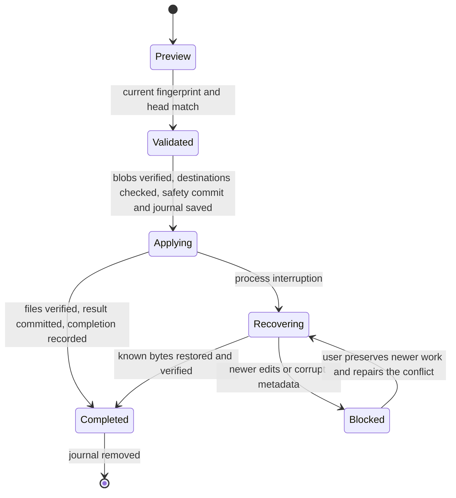

# Engineering ownership and robustness

## Responsibilities

The application service owns the lifetime of each operation and its lock. Adapters do not decide
when to commit, restore or recover. Restore is the only workflow permitted to replace workspace
bytes, and it always goes through `WorkspaceFiles`. Perforce metadata mutations have a separate
adapter; application services never issue arbitrary Perforce commands supplied by callers.

| Component | Owns | Boundary |
| --- | --- | --- |
| `server.py` | MCP names, schemas, annotations, agent instructions | Delegates each call to the application service |
| `cli.py` | Process configuration and service construction | Does not implement history operations |
| `history.py` | Operation orchestration and locking | Composes components; no raw file writes or subprocesses |
| `capture.py` | Reading a consistent, bounded changelist snapshot | Depends on a read-only Perforce protocol; does not publish commits |
| `p4.py` | Perforce CLI transport, decoding, identity and mappings | Explicit client; reader methods do not mutate; failed commands never become snapshots |
| `workspace.py` / `paths.py` | Workspace byte reads, path validation, preflight and file replacement | No Perforce or Git commands; rejects aliases and redirected paths |
| `store.py` | Git objects, commit ancestry, ref publication and integrity checks | No workspace writes or Perforce dependency; network protocols disabled |
| `state.py` | Local locking, connection binding, plans and recovery journals | Bounded metadata reads, validation and atomic file replacement |
| `restore.py` | Restore/recovery state transitions and their invariants | Runs under the application's lock; preflights before writing and verifies afterwards |
| `transitions.py` | Edit/add/delete membership restore and recovery | Separate typed transaction, auxiliary unopened-file safety snapshot, no sync or submit |
| `operations.py` | Explicit Perforce create/open/close/type operations | Validated literal paths, read-only add preview, no raw caller commands |
| `prepare.py` | Scoped pre-edit protection | Publishes verified baseline before opening files; retries preserve partial progress |
| `continuity.py` | Task history across changelist moves | Checks exact metadata union; retains source history and adds explicit lineage |
| `merge.py` | Three-way merge and cherry-pick planning | Conflicts never write workspace bytes; stages a verified restore target |
| `hooks.py` | Active task, observed file creation and host checkpoints | Bounded JSON input, no shell evaluation; arbitrary shell writes require explicit preparation |
| `hook_install.py` | User hook registration/removal | Preserves custom entries and policies; ownership receipts, backups and idempotent updates |
| `models.py` | Persisted record contracts and validation | Rejects unknown versions/fields, invalid identities, duplicate paths and invalid content references |
| `diff.py` | Snapshot comparison and bounded text rendering | Receives a blob reader; large files get summaries without loading content |
| `codec.py` / `limits.py` | Canonical encoding, content IDs and shared limits | No I/O or workflow policy |
| `scripts/build_windows.py` / `windows_entry.py` | Frozen Windows runtime, file manifest, zip and external DLL-search compatibility | Maintainer-only packaging; no workspace or client configuration changes |
| `.agents/skills/setup-p4-history/scripts/install.ps1` | Per-user installation, workspace verification, config backup and native MCP registration | Does not edit Perforce files, submit changelists, move history or change global policy/PATH |
| `source-runtime.ps1` beside the installer | Pinned uv bootstrap when needed, committed source export and locked Python environment | Creates a separate runtime; never installs an editable reference to the setup checkout |

The installer uses a Git-revision directory for source installs or a content-addressed directory
for bundles, retaining older runtimes. The Python environment is created at its final location
because Windows virtual environments contain absolute paths. Source installs reject dirty runtime
inputs and incomplete installs; they do not silently adopt partially installed environments. Registration
receipts distinguish its own entries from externally created/customised ones. Native client
commands preserve unrelated entries; update failures restore the config backup when available.
An interrupted setup can leave a staging directory or an entry without its ownership receipt;
the installer conservatively refuses to adopt that entry. Remove that specific MCP registration
with the host's CLI before retrying, after preserving any custom settings. Setup is not coordinated
with other config writers: run one instance at a time and do not edit client config concurrently.

The original MCP tool names remain available, with additional task, branch, merge and inspection
tools. The CLI exposes an explicit operation allowlist. Tests inject failures at their owning
boundary: file replacement, state persistence, Perforce responses or Git objects.

## Failure invariants

1. **A reported commit has verified bytes.** Capture validates current metadata and reads each
   file twice. Storage checks the captured content against the manifest and verifies the actual
   persisted blob, including when Git reuses an existing object. The ref advances atomically with
   an expected previous value. Failed writes may leave unreachable objects, but do not claim a
   successful commit.
2. **Partial Perforce output is a failure.** A nonzero exit is rejected even if some structured
   records arrived. Only a specifically recognised, otherwise empty Perforce result is accepted
   as an empty changelist. Opened-file counts are limited before mapping; paths are mapped in a
   batch without a shell or a full workspace scan.
3. **Restore writes follow validated intent.** A typed preview binds an exact target, current
   fingerprint, history head and operation list. Its operations are checked again at apply time.
   Every target blob and destination is validated before the safety commit and first file write.
4. **Interrupted writes remain recoverable.** The safety commit and applying journal exist before
   workspace replacement. Recovery validates the entire affected-file list against both snapshots
   and refuses unknown newer bytes. It verifies the expected final snapshot before recording success.
5. **Cleanup does not undo completion.** A completed journal records the resulting commit before
   deletion. If cleanup fails, recovery validates that completion record and only removes the
   journal, preserving later edits without requiring a live Perforce connection or pending
   changelist. A crash between publishing the result commit and recording
   completion is conservatively treated as interrupted and can restore the safety snapshot.
6. **Corrupt state is not silently reset.** Malformed metadata produces an actionable error.
   A damaged Git repository is not automatically reinitialised, and a nonempty store with a missing
   workspace binding is not silently adopted by another connection. Restore the binding from backup
   or repair the store explicitly; do not delete state to bypass these checks.

## Regression evidence

The engineering pass first reproduced six failures in the prototype: acceptance of partial
Perforce failures, corrupted blobs reaching workspace writes, silent reinitialisation of damaged
repositories, unhandled malformed plans, recovery success after a late concurrent edit, and
acceptance of an incomplete recovery file list. Each case now has a regression test.

Additional tests exercise an actual child-process exit after the first restored file, process-level
lock contention, interruption after completion but before journal deletion, read-only-file
preflight, missing bindings, corrupt existing objects during commit, malformed response records,
metadata schema violations, path aliases and bounded diffs. Disposable-server integration tests
cover the real Perforce adapter and the MCP stdio transport.

## Remaining operational boundaries

This remains a local content-history tool, not a transaction across Perforce, the editor and the
filesystem. Locks coordinate instances using the same state directory. Another editor can still
write in the interval between a check and replacement; pause external writers during restore.
Per-file replacement and flushed journal files do not guarantee multi-file atomicity or survival
of every power-loss scenario. Snapshot reads and restores require an existing Perforce workspace.

Move pairs, integration/resolve state, base-revision changes, large binary streaming and automatic
retention remain outside this release. Explicit packing preserves history. MCP guidance requests
semantic milestone commits; host hooks add checkpoints for recognised tools but cannot cover
arbitrary writers or a host that disables or times out hooks. Active hook task selection is
workspace-wide, so concurrent sessions must coordinate their task selection.

Changelist restoration protects currently unopened bytes in a separate pinned safety snapshot.
The journal binds its file operations to independently hashed before/target manifests. Recovery
accepts only known intermediate metadata and before/target bytes. Closing a tracked edit retains
its bytes; reverting a task add removes its file after saving it. Changes to Perforce base
revisions or newer bytes block recovery. No operation claims an atomic transaction with Perforce.

GitHub Actions is intentionally disabled for this repository and its workflow file has been
removed at the owner's request. Local Windows tests provide execution evidence; Linux execution
is still outstanding.
